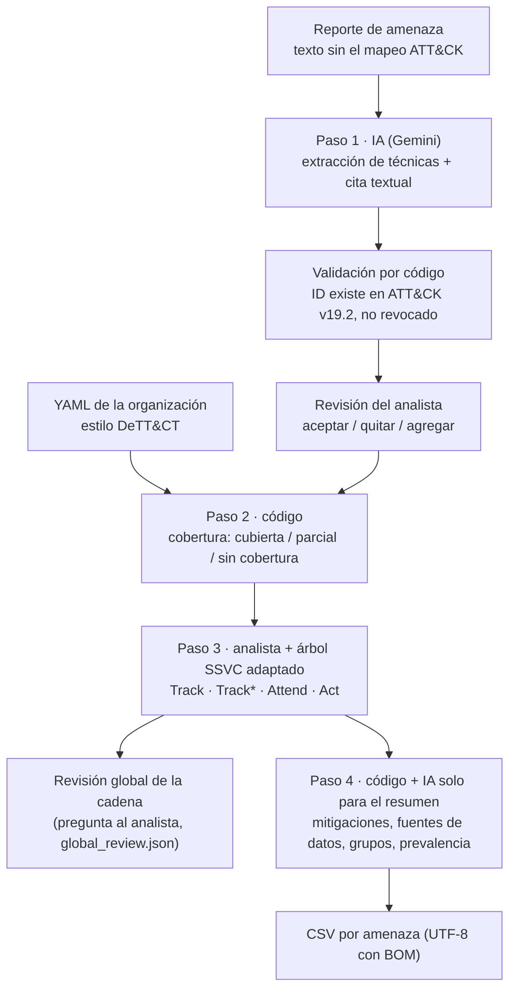

English: [README.md](README.md)

# attack-exposure-model

Prototipo mínimo del modelo propuesto en el Trabajo Final de Graduación:

> **«Diseño de un modelo de evaluación de amenazas cibernéticas asistido por inteligencia artificial basado en MITRE ATT&CK para entornos empresariales»**
> Sebastián Murillo Mora · Licenciatura en Ingeniería en Sistemas de Computación · Universidad Fidélitas, Costa Rica · 2026

**Idioma:** la documentación de `docs/` y los mensajes de la línea de comandos están en español, porque este trabajo es una tesis de la Universidad Fidélitas (Costa Rica). El código, los comentarios, los mensajes de commit, los prompts del LLM, los resúmenes del paso 4 (D-45) y los nombres de columnas de las salidas están en inglés; algunos valores de celda (p. ej. `sin cobertura`, `sin dato disponible`) están en español.

## Qué es y qué NO es

**Es** un prototipo de línea de comandos que se publica **solo para que las simulaciones de la tesis se puedan reproducir**. Dado un reporte de amenaza (texto) y el perfil de una organización **ficticia**, produce un CSV con las técnicas de MITRE ATT&CK descritas en el reporte, la capacidad de detección que la organización tiene para cada una y la acción que asigna el analista.

**No es** una herramienta lista para producción, no detecta compromisos, no reemplaza a un analista y no se ha validado fuera de los escenarios de la tesis. La salida **no afirma que la organización haya sido comprometida**.

## Idea central

El modelo **no detecta si una organización fue comprometida**. Evalúa **para qué técnicas de ATT&CK la organización está expuesta o no tiene capacidad de detección**, dado un reporte de amenaza.

Por qué técnicas y no indicadores de compromiso (IoC): una IA puede mutar con facilidad los artefactos de un ataque (hashes, IP, dominios, código), pero no el comportamiento que el atacante necesita ejecutar. El indicador 3 de la evaluación mide exactamente eso, comparando el modelo con un enfoque tradicional basado en IoC.

### Principio de diseño

**IA donde hay lenguaje natural, código donde hay datos estructurados, criterio humano donde hay consecuencias.**

- La IA hace **solo dos cosas**: (1) extraer y mapear técnicas ATT&CK desde el texto del reporte; (2) condensar la descripción larga de una técnica en un resumen breve.
- La IA **nunca** asigna prioridades, urgencia ni recomienda acciones. Esto se garantiza **por arquitectura**: el esquema de salida del LLM tiene campos fijos y ninguno es evaluativo (`technique_id`, `technique_name`, `evidence_quote`; y `summary`), y la acción se calcula en un paso donde la IA no participa. El prompt también lo prohíbe, pero el diseño no depende de eso. Un filtro de código descarta cualquier resumen con lenguaje evaluativo que no esté en la fuente.

## Flujo



| Paso | Quién | Qué hace |
|---|---|---|
| 1 | IA + código + analista | El LLM devuelve técnicas con una cita del reporte. El código valida cada ID contra ATT&CK v19.2 y marca `needs_review` los inválidos o deprecados (no los descarta en silencio). El analista revisa. Se guardan por separado `extracted_raw` y `extracted_validated`. |
| 2 | Código | Cruza cada técnica con las detecciones del YAML (escala de DeTT&CT 0–5): 0 o sin entrada → `sin cobertura`; 1–3 → `parcial`; 4–5 → `cubierta`. |
| 3 | Analista + tabla | Árbol adaptado de SSVC v2.0 (cobertura × criticidad del activo; la exposición solo ajusta las técnicas de Acceso Inicial). Tabla editable en `data/ssvc_tree.yaml`. |
| 4 | Código + IA | Resumen breve (IA, máx. 3 oraciones, en inglés), enlace a attack.mitre.org (por código), mitigaciones `M####`, fuentes de datos, grupos y prevalencia (Red Canary 2026). Sin campos de urgencia, riesgo ni recomendación. |

## Instalación

Requisitos: **Python 3.11 o superior** y `git`.

**Linux / macOS**

```bash
git clone https://github.com/Mumogg/attack-exposure-model.git
cd attack-exposure-model
python3 -m venv .venv
source .venv/bin/activate
pip install -e ".[dev]"
```

**Windows (PowerShell)**

```powershell
git clone https://github.com/Mumogg/attack-exposure-model.git
cd attack-exposure-model
py -3.11 -m venv .venv
.venv\Scripts\Activate.ps1
pip install -e ".[dev]"
```

Luego, en cualquier sistema:

```bash
aem fetch-data      # descarga ATT&CK v19.2 (verifica su SHA-256) y prepara los boletines de CISA
pytest              # ninguna prueba llama a la API real
```

`aem --help` y `aem <comando> --help` muestran la ayuda en español; `aem --version` muestra la versión declarada en `pyproject.toml`.

**Versiones exactas (opcional).** `requirements.lock` fija cada dependencia tal como se instaló para la tesis. Se generó con **Python 3.14.7** en Linux (venv limpio, `pip install -e ".[dev]"` + `pip freeze`), el intérprete de las corridas de la tesis. Sirve solo para reproducir ese entorno, con Python 3.14.7: `pip install -r requirements.lock && pip install -e . --no-deps`. El CI lo instala así y corre los tests. **No** se instala en Python 3.11 (`numpy` 2.5.4 y `contourpy` 1.4.0 no tienen wheels para 3.11); en 3.12 y 3.13 todas las versiones fijadas se resuelven, pero ahí no se corren los tests con el lock. La instalación normal, para cualquier versión soportada (≥ 3.11), sigue siendo `pip install -e ".[dev]"`.

**Integración continua.** `.github/workflows/tests.yml` corre `pytest` con Python 3.11 y 3.12 en cada push y pull request. Instala con `pip install -e ".[dev]"` y ejecuta `aem fetch-data`, para que los tests de ATT&CK no se omitan. Tiene permisos de solo lectura y ningún secreto ni API key; `tests/conftest.py` hace fallar cualquier test que intente llegar a la API de Gemini.

Pasos para correr los experimentos reales (API key, Akira, prevalencia, `aem eval`, revisión manual, qué versionar): `docs/RUNBOOK.md`.

## API key de Gemini

Solo hace falta para correr el modelo con reportes nuevos o para regenerar las respuestas del LLM.

1. Cree una clave en Google AI Studio (https://aistudio.google.com/). **La capa gratuita no alcanza para el experimento completo**: el 2026-10-18 la API informó, para `gemini-3.8-flash`, una cuota de 20 solicitudes por día y por proyecto (`GenerateRequestsPerDayPerProjectPerModel-FreeTier`), y `aem eval` necesita más de 80. Las corridas de la tesis se hicieron con la facturación activada en el proyecto (D-75). El modo demo no necesita clave.
2. Copie `.env.example` como `.env` y complete `GEMINI_API_KEY=`.
3. Opcional: `GEMINI_MODEL` (por defecto `gemini-3.8-flash`; alternativo `gemini-3.5-flash-lite`) y `GEMINI_RPM` (solicitudes por minuto; por defecto 10, valor aproximado, no oficial).

`.env` está en `.gitignore`: **nunca** suba su clave al repositorio. En la primera llamada el programa verifica que el modelo exista y, si no, sugiere el alternativo.

## Modo demo (sin API key)

Toda respuesta del LLM se guarda en `runs/llm_cache/` con clave = SHA-256 de (modelo + prompt + parámetros + esquema + número de réplica). Con `--demo` el programa usa **solo** esa caché y, si falta una respuesta, se detiene con un mensaje claro.

Antes del primer `aem demo`, descargue los datos de ATT&CK v19.2 (no necesita API key):

```bash
aem fetch-data                    # una sola vez: ATT&CK v19.2 + verificación de checksum
aem demo                          # escenario Gunra (AA26-222A) de punta a punta, sin API key
aem eval --demo                   # experimento completo desde la caché
```

Las solicitudes construidas con el texto de Akira (derechos de autor) se guardan en `runs/llm_cache_private/`, que **no** se publica: quien clone el repositorio reproduce Gunra e Interlock, y Akira aparece como «sin caché privada» (D-69).

La caché pública `runs/llm_cache/` contiene las respuestas reales de la corrida `2026-10-18-main` (Gunra e Interlock), así que `aem demo` y `aem eval --demo` funcionan sin API key. El escenario Akira no está en la caché pública: su texto es de The DFIR Report y no se redistribuye. Sin ese texto, el modo demo usa Gunra e Interlock, y `aem eval --demo` marca a Akira como escenario omitido (resultado parcial, D-73).

## Uso

```bash
aem run --report data/reports/gunra_aa26-222a_stripped.txt --org data/org/fictional_org.yaml \
        --analyst-mode interactive --out salida/gunra
```

- `--analyst-mode interactive`: el analista revisa en la terminal la lista del paso 1, valida la cobertura, indica criticidad (y exposición en Acceso Inicial) y responde la revisión global.
- `--analyst-mode auto`: solo para experimentos; acepta lo válido y toma criticidad y exposición de `analyst_context` del YAML.

Archivos de salida en `--out`:

- `<reporte>_exposure.csv` — una fila por técnica, columnas fijas: `technique_id, technique_name, tactics, coverage_validated, criticality, exposure, action, summary, source_link, mitigations, data_sources, groups, prevalence`. Orden: por acción (`Act`, `Attend`, `Track*`, `Track`) y, dentro de cada grupo, por secuencia de ataque (orden de las tácticas leído de la matriz de ATT&CK v19.2). El script no establece prioridades entre técnicas con la misma acción. `exposure` solo se llena en técnicas de Acceso Inicial.
- `global_review.json` — respuesta del analista a: *«¿Existe algún punto de la cadena en el que la organización cuente con cobertura suficiente para interrumpir el ataque?»*. El script no responde ni sugiere la respuesta; en modo `auto` queda `answer: null`.
- `run_record.json` — auditoría: lista cruda y validada, acciones del analista, cobertura original y validada, cada resumen, modelo, temperatura, versión de ATT&CK y SHA-256 del reporte y de los prompts.

**Idioma de los resúmenes:** se generan en inglés, el idioma de la descripción fuente de ATT&CK, para que los chequeos de fidelidad y de límites comparen textos en el mismo idioma (D-45).

### Comandos

| Comando | Qué hace |
|---|---|
| `aem fetch-data` | Descarga ATT&CK v19.2 y los boletines de CISA; genera los textos, las versiones `stripped` y los mapeos de referencia. |
| `aem prepare-reports` | Prepara el texto de Akira que usted coloque (y regenera los de CISA con `--force`). |
| `aem suggest-anon-names` | Propone los nombres de la amenaza que la versión `anon` debería reemplazar (`--scenario akira`), con su conteo y contexto. No modifica `data/anon_names.yaml`; escribe la lista en `data/reports/private/` (ignorada por git). |
| `aem make-variants` | Genera las versiones `mut` (IoC cambiados) y `anon` (además, nombres de la amenaza cambiados) de cada reporte, y los IoC «conocidos» de la organización. Falla si algún IoC o nombre del original sobrevive. |
| `aem run` | Corre los 4 pasos sobre un reporte. |
| `aem preflight` | Comprueba que todo está listo antes de gastar llamadas (OK / FALTA / AVISO) y estima llamadas y tiempo. |
| `aem eval` | Corre el experimento completo y genera las tablas de los 5 indicadores. Ejecuta antes el preflight y no arranca si hay un FALTA. Use siempre `--run-id <fecha>`. |
| `aem report` | Resume una corrida real (`--run-id <fecha>`) en `docs/resultados/<fecha>/`: una tabla por indicador, gráficos de los indicadores 1 y 3, datos faltantes y límites (C1–C3, D-67). Se niega con resultados FAKE. |
| `aem report --html` | Una sola página autocontenida (CSS y JS en línea, funciona sin conexión) en `runs/<fecha>/results/report.html`: los cinco indicadores con gráficos y tablas, modelo frente al enfoque tradicional, acciones, cobertura y un mapa por táctica de ATT&CK, una tabla de técnicas filtrable, sensibilidad, limitaciones y la declaración de IA. En inglés, con un botón para pasar a español. Citas de evidencia solo de los reportes públicos (CISA). `--private` escribe además `runs/<fecha>/private/report_full.html` (ignorado por git, con las citas de Akira). Antes de escribir, la página pública se compara con la copia local del reporte de DFIR (ventanas de 8 palabras y valores de IoC). |
| `aem sensitivity` | Análisis de sensibilidad sin la API (`--run-id <fecha>`): recalcula los pasos 2 y 3 y el indicador 3 cambiando un parámetro a la vez (`covered_min` 3/4/5, `partial_min` 1/2, `no_inherit`/`inherit_parent`), en `runs/<fecha>/results/sensitivity/`. Es un complemento, no un resultado principal: la configuración confirmada no cambia, y la fila con los parámetros actuales debe ser igual al indicador 3 de `results.json` (D-77). |
| `aem review-check` | Valida las hojas de revisión manual de los indicadores 4 y 5 (`--run-id <fecha>`): solo si/no, observación en la respuesta negativa, ninguna columna generada modificada; informa «revisión incompleta: N de M filas» y nunca un porcentaje hasta que todas las hojas estén completas. |
| `aem check-repo` | Revisa los archivos versionados y todo el historial de git en busca de `.env`, API keys, texto y valores de IoC del reporte de DFIR, y archivos `private/`. Busca además 8 palabras seguidas del reporte de DFIR en el índice y en los archivos nuevos no ignorados (`--deep`: en cada versión de cada archivo del historial). Obligatorio antes de subir a GitHub. |
| `aem demo` | Atajo: Gunra en modo demo. |

## Reproducir los resultados de la tesis

```bash
aem fetch-data
# Opcional (Akira): coloque el texto en data/reports/akira_dfir_2026.txt (ver docs/report_preparation.md)
aem prepare-reports
aem make-variants
aem preflight
aem eval --run-id 2026-10-20   # con API key; o `aem eval --demo --run-id …` con la caché publicada
aem report --run-id 2026-10-20
aem sensitivity --run-id 2026-10-20     # complemento opcional (D-77)
aem report --html --run-id 2026-10-20   # página autocontenida; con --private, la copia completa local
```

`aem eval` corre **3 escenarios × 3 versiones (`orig`, `mut`, `anon`) × 5 corridas** con los mismos parámetros (`temperature = 0`) y reporta media y desviación estándar. Resultados en `runs/<fecha>/results/` (`results.md`, CSV y JSON; cada tabla lleva modelo, versión, fecha y hash de las plantillas de prompt) y hojas de revisión manual en `eval/review_sheets/`. Si alguna respuesta no proviene de la API real de Gemini (p. ej. un LLM simulado en pruebas), todo va a `runs/<fecha>/results_FAKE/` con prefijo `FAKE_` y nunca a `results/` (D-71). La estimación de llamadas y tiempo está en `docs/PLAN.md` (≈ 125–165 llamadas, 25–45 minutos con `GEMINI_RPM=10`). En los indicadores 1 y 3 la media principal es `_fail0` (las corridas fallidas cuentan como 0); `_valid` es secundaria (D-67). El paso a paso completo está en `docs/RUNBOOK.md`.

| Indicador | Qué mide |
|---|---|
| 1 | Precisión y exhaustividad del paso 1 (`extracted_raw` frente al mapeo de referencia), a nivel de sub-técnica exacta y de técnica padre, con las omitidas y erróneas. |
| 2 | Corrección del cruce de cobertura del paso 2 sobre la lista de referencia frente a las brechas declaradas en `coverage_design` (debe dar 100 %). |
| 3 | Persistencia: porcentaje de técnicas cuya brecha (modelo) o presencia (enfoque tradicional por IoC) se reconoce en `mut` (IoC modificados) y en `anon` (IoC y nombres de la amenaza modificados), frente al original. |
| 4 | Fidelidad de los resúmenes: hoja de revisión manual + chequeo automático básico. |
| 5 | Cumplimiento de los límites: campos o lenguaje evaluativo en cualquier salida de la IA (+ muestra para revisión manual). |

No hay indicador para el paso 3 ni para la revisión global: son criterio del analista.

## Estructura del repositorio

```
├── src/aem/              código del modelo (CLI, 4 pasos, cliente Gemini, preparación de reportes)
│   └── prompts/          plantillas de prompt versionadas (su SHA-256 se registra)
├── eval/                 variantes, enfoque tradicional, métricas, experimento; review_sheets/
├── data/
│   ├── attack/           checksum de ATT&CK v19.2 (el JSON se descarga con fetch-data)
│   ├── org/              organización ficticia (borrador) e IoC conocidos generados
│   ├── reports/          boletines de CISA (texto, stripped, variante mut, diff)
│   ├── reference_mappings/  técnicas de referencia por escenario
│   ├── prevalence/       plantilla de prevalencia de Red Canary (la llena Sebas)
│   ├── scenarios.yaml  ssvc_tree.yaml  model_config.yaml  boundary_patterns.yaml
├── runs/                 respuestas del LLM (caché) y resultados de las corridas
├── docs/                 PLAN, DECISIONS, report_preparation, RESUMEN_PARA_TESIS, lab_notes
└── tests/
```

## Datos

- **MITRE ATT&CK Enterprise v19.2** (`enterprise-attack-19.2.json`, https://github.com/mitre-attack/attack-stix-data). No se versiona; `aem fetch-data` lo descarga y verifica su SHA-256.
- **Boletines de CISA** #StopRansomware **AA26-222A** (Gunra, 10/08/2026) y **AA25-203A** (Interlock, 22/07/2025). Son documentos del gobierno de EE. UU. y **se incluyen** en el repositorio (texto convertido y versión sin el mapeo ATT&CK).
- **The DFIR Report**, «From Bing search to ransomware: BumbleBee and AdaptixC2 deliver Akira» (29/06/2026). **No se incluye**: tiene derechos de autor. El repositorio contiene solo el enlace, las instrucciones para colocar el texto (`docs/report_preparation.md`) y el mapeo de referencia (solo IDs y nombres de técnicas).
- **Red Canary (2026), *2026 Threat Detection Report***: la plantilla `data/prevalence/red_canary_2026.csv` está vacía hasta que Sebas la llene; mientras tanto, la prevalencia dice `sin dato disponible`.
- La organización `data/org/fictional_org.yaml` es **ficticia**.

Antes de dárselo al LLM, de cada reporte se elimina la sección del mapeo ATT&CK y **todo ID** de técnica o táctica del cuerpo; una prueba falla si queda alguno (`docs/report_preparation.md`).

## Limitaciones

- **Prototipo de tesis**, evaluado solo con tres escenarios y una organización ficticia; los resultados no se generalizan.
- **El paso 3 no se valida de forma independiente**: en la simulación lo realiza el autor con la criticidad y la exposición definidas de antemano en `analyst_context` del YAML (modo `auto`). La revisión global queda sin responder en ese modo.
- **Las brechas de cobertura de la organización las define el autor** (`coverage_design`); el indicador 2 verifica el código del paso 2, no la calidad del perfil.
- **Adaptaciones propias, pendientes de validación**: umbrales de cobertura sobre la escala de DeTT&CT, la política de sub-técnicas, la tabla SSVC adaptada a técnicas adversarias, el enfoque tradicional por IoC (simplificado: una coincidencia basta) y las reglas de extracción de IoC. Todas están en `docs/DECISIONS.md` y son configurables.
- **El LLM no es determinístico** aun con `temperature = 0`; por eso se hacen 5 corridas. Los resultados dependen del modelo y la fecha (se registran ambos).
- Los resúmenes del paso 4 se generan **una vez por técnica** (caché compartida entre escenarios y corridas); los indicadores 4 y 5 los evalúan una vez por técnica.
- El chequeo automático de los resúmenes y la lista de patrones evaluativos son aproximaciones; la revisión manual de una muestra es parte del método.
- En ATT&CK v18+ las fuentes de datos se modelan como componentes de datos de las estrategias de detección; la columna `data_sources` lista esos componentes (D-03, confirmada).
- Los límites de Gemini (`GEMINI_RPM` y las cuotas diarias) no son cifras oficiales del proyecto y pueden cambiar. Las corridas de la tesis usan la capa de pago (D-75). Cada 429 queda registrado con su cuota en `runs/<run-id>/api_events.jsonl` (D-74).
- **C1 — El enfoque tradicional da 0 % por construcción:** en `mut` y `anon` ningún IoC del original sobrevive (lo verifica el código), así que el enfoque tradicional siempre da 0 %. Es un punto de referencia, **no una medición independiente**.
- **C2 — Reconocimiento por el nombre:** `mut` conserva los nombres del actor y del malware, así que parte de la persistencia del modelo en `mut` podría deberse a que el LLM reconoce la amenaza por su nombre y no por el comportamiento. La versión `anon`, que reemplaza esos nombres, sirve para controlarlo (D-72).
- **C3 — Datos de entrenamiento:** el modelo de lenguaje pudo conocer estos reportes (públicos) durante su entrenamiento; ni `mut` ni `anon` eliminan ese efecto.

Las decisiones de diseño están en `docs/DECISIONS.md`. Al 2026-10-18 ninguna está marcada **PENDIENTE DE CONFIRMAR**: las que se tomaron sin confirmación explícita del autor ya están marcadas **CONFIRMADA**.

## Licencia

MIT (ver `LICENSE`). Los datos de terceros conservan sus propias condiciones (ATT&CK: términos de uso de MITRE; boletines de CISA: dominio público de EE. UU.; The DFIR Report: no incluido).

## Cómo citar

```bibtex
@software{murillo_attack_exposure_model_2026,
  author  = {Murillo Mora, Sebastián},
  title   = {attack-exposure-model: prototipo de un modelo de evaluación de amenazas cibernéticas asistido por IA basado en MITRE ATT\&CK},
  year    = {2026},
  version = {0.1.0},
  url     = {https://github.com/Mumogg/attack-exposure-model},
  note    = {Trabajo Final de Graduación, Universidad Fidélitas. [PENDIENTE: versión publicada]}
}
```

## Declaración de uso de IA en el desarrollo

El código de este repositorio fue escrito con asistencia de Claude Code (Anthropic), bajo la dirección de Sebastián Murillo Mora. El diseño del modelo, las decisiones técnicas (ver `docs/DECISIONS.md`), la evaluación y la interpretación de los resultados son del autor.

Revisada por el autor el 2026-10-18.
