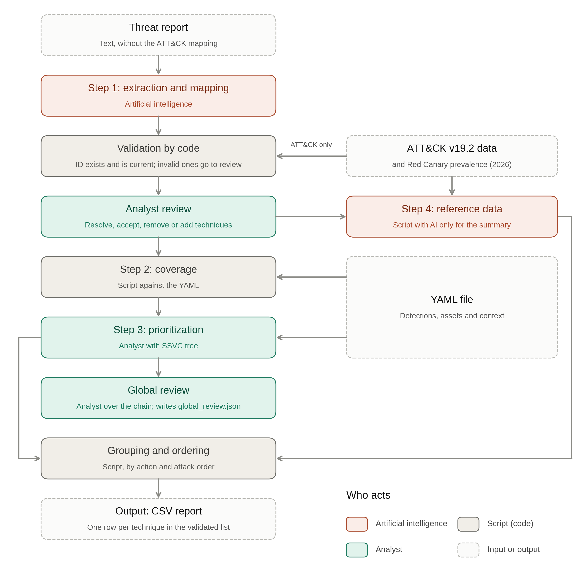

Español: [README.es.md](README.es.md)

# attack-exposure-model

Minimal prototype of the model proposed in the undergraduate thesis (Trabajo Final de Graduación):

> **«Diseño de un modelo de evaluación de amenazas cibernéticas asistido por inteligencia artificial basado en MITRE ATT&CK para entornos empresariales»** (Design of an AI-assisted cyber threat evaluation model based on MITRE ATT&CK for enterprise environments)
> Sebastián Murillo Mora · Licenciatura en Ingeniería en Sistemas de Computación · Universidad Fidélitas, Costa Rica · 2026

**Language:** the documentation in `docs/` and the command-line messages are in Spanish, because this work is a thesis at Universidad Fidélitas (Costa Rica). The code, comments, commit messages, LLM prompts, step 4 summaries (D-45) and the column names of the outputs are in English; some cell values (e.g. `sin cobertura`, `sin dato disponible`) are in Spanish.

## What it is and what it is NOT

**It is** a command-line prototype published **only so that the thesis simulations can be reproduced**. Given a threat report (text) and the profile of a **fictional** organization, it produces a CSV with the MITRE ATT&CK techniques described in the report, the detection capability the organization has for each one, and the action assigned by the analyst.

**It is not** a production-ready tool, it does not detect compromises, it does not replace an analyst, and it has not been validated outside the thesis scenarios. The output **does not claim that the organization has been compromised**.

## Central idea

The model **does not detect whether an organization was compromised**. It assesses **for which ATT&CK techniques the organization is exposed or lacks detection capability**, given a threat report.

Why techniques and not indicators of compromise (IoC): an AI can easily mutate the artifacts of an attack (hashes, IPs, domains, code), but not the behavior the attacker needs to execute. Indicator 3 of the evaluation measures exactly that, comparing the model with a traditional IoC-based approach.

### Design principle

**AI where there is natural language, code where there is structured data, human judgment where there are consequences.**

- The AI does **only two things**: (1) extract and map ATT&CK techniques from the report text; (2) condense the long description of a technique into a brief summary.
- The AI **never** assigns priorities or urgency, nor recommends actions. This is guaranteed **by architecture**: the LLM output schema has fixed fields and none of them is evaluative (`technique_id`, `technique_name`, `evidence_quote`; and `summary`), and the action is computed in a step where the AI does not take part. The prompt also forbids it, but the design does not depend on that. A code filter discards any summary with evaluative language that is not in the source.

## Flow



Each run also saves run_record.json (traceability record).

Colors: red = AI, grey = script (code), green = analyst, dashed = input or output. Every run also writes `run_record.json` as its traceability record.

| Step | Who | What it does |
|---|---|---|
| 1 | AI + code + analyst | The LLM returns techniques with a quote from the report, with a fixed schema (`technique_id`, `technique_name`, `evidence_quote`). The code validates each ID against ATT&CK v19.2: malformed, not found, revoked or deprecated IDs are marked `needs_review` (they are not discarded silently). The code also checks whether the quote appears in the report, but that is only a flag shown to the analyst: it does not exclude anything. The analyst resolves the `needs_review` items (replace or remove) and accepts, removes or adds techniques. `extracted_raw` and `extracted_validated` are stored separately. |
| 2 | Code | Matches each technique against the YAML detections using only the score (DeTT&CT scale 0–5): 0 or no entry → `sin cobertura`; 1–3 → `parcial`; 4–5 → `cubierta`. The entry's `data_sources` are only copied to the record. Sub-techniques without their own entry do not inherit the parent's score (`subtechnique_policy: no_inherit`, the default). |
| 3 | Analyst + table | The analyst first validates the step 2 coverage, then states the asset criticality (and exposure, only for Initial Access techniques). Tree adapted from SSVC v2.0: coverage × criticality, with exposure shifting only Initial Access techniques. Editable table in `data/ssvc_tree.yaml`. `processes_regulated_data` is only shown to the analyst; it is not an input of the tree. |
| Global review | Analyst | With the techniques in attack-chain order and their validated coverage, the analyst answers whether there is a point where the organization could interrupt the attack. It only writes `global_review.json`; it does not feed any other stage. |
| 4 | Code + AI | Depends only on the validated list from step 1 (not on steps 2 and 3). One batch lookup of ATT&CK data: link to attack.mitre.org, `M####` mitigations, data sources, groups; plus prevalence from `data/prevalence/red_canary_2026.csv`. The AI only condenses the description (max. 3 sentences, in English); a code check then replaces with `resumen no disponible` any summary with evaluative language that is not in the source. That CSV is empty in the frozen run (D-78), so prevalence shows `sin dato disponible`. No urgency, risk or recommendation fields. |
| Output | Code | Joins steps 3 and 4: one CSV row per validated technique, grouped by action (Act, Attend, Track*, Track) and in attack-chain order within each group. It does not rank techniques that share an action. `run_record.json` keeps the trace of every step. |

**Analyst mode.** `interactive` (the default in `aem run`): a person makes every analyst decision above. `auto` (experiments only): `AutoReviewer` excludes the `needs_review` items without adding or removing anything, `AutoAnalyst` keeps the step 2 coverage and takes criticality and exposure from `analyst_context` in the YAML, and the global review is left unanswered. The evaluation always used `auto`.

## Installation

Requirements: **Python 3.11 or later** and `git`.

**Linux / macOS**

```bash
git clone https://github.com/Mumogg/attack-exposure-model.git
cd attack-exposure-model
python3 -m venv .venv
source .venv/bin/activate
pip install -e ".[dev]"
```

**Windows (PowerShell)**

```powershell
git clone https://github.com/Mumogg/attack-exposure-model.git
cd attack-exposure-model
py -3.11 -m venv .venv
.venv\Scripts\Activate.ps1
pip install -e ".[dev]"
```

Then, on any system:

```bash
aem fetch-data      # downloads ATT&CK v19.2 (verifies its SHA-256) and prepares the CISA advisories
pytest              # no test calls the real API
```

`aem --help` and `aem <command> --help` show the help in Spanish; `aem --version` prints the version declared in `pyproject.toml`.

**Exact versions (optional).** `requirements.lock` pins every dependency as installed for the thesis. It was generated with **Python 3.14.7** on Linux (clean venv, `pip install -e ".[dev]"` + `pip freeze`), the interpreter of the thesis runs. It is only for reproducing that environment, with Python 3.14.7: `pip install -r requirements.lock && pip install -e . --no-deps`. CI installs it that way and runs the tests. It does **not** install on Python 3.11 (`numpy` 2.5.4 and `contourpy` 1.4.0 have no 3.11 wheels); on 3.12 and 3.13 every pinned version resolves, but the tests are not run there with the lock. The normal install, for any supported version (≥ 3.11), is still `pip install -e ".[dev]"`.

**Continuous integration.** `.github/workflows/tests.yml` runs `pytest` on Python 3.11 and 3.12 on every push and pull request. It installs with `pip install -e ".[dev]"` and runs `aem fetch-data`, so the ATT&CK tests are not skipped. It has read-only permissions and no secrets or API key; `tests/conftest.py` fails any test that tries to reach the Gemini API.

Steps to run the real experiments (API key, Akira, prevalence, `aem eval`, manual review, what to version): `docs/RUNBOOK.md`.

## Gemini API key

Only needed to run the model on new reports or to regenerate the LLM responses.

1. Create a key in Google AI Studio (https://aistudio.google.com/). **The free tier is not enough for the full experiment**: on 2026-10-18 the API reported, for `gemini-3.8-flash`, a quota of 20 requests per day per project (`GenerateRequestsPerDayPerProjectPerModel-FreeTier`), and `aem eval` needs more than 80. The thesis runs were made with billing enabled on the project (D-75). Demo mode needs no key.
2. Copy `.env.example` to `.env` and fill in `GEMINI_API_KEY=`.
3. Optional: `GEMINI_MODEL` (default `gemini-3.8-flash`; alternative `gemini-3.5-flash-lite`) and `GEMINI_RPM` (requests per minute; default 10, approximate value, not official).

`.env` is in `.gitignore`: **never** commit your key to the repository. On the first call the program checks that the model exists and, if it does not, suggests the alternative.

## Demo mode (no API key)

Every LLM response is stored in `runs/llm_cache/` with key = SHA-256 of (model + prompt + parameters + schema + replicate number). With `--demo` the program uses **only** that cache and, if a response is missing, stops with a clear message.

Before the first `aem demo`, download the ATT&CK v19.2 data (no API key needed):

```bash
aem fetch-data                    # once: ATT&CK v19.2 + checksum verification
aem demo                          # Gunra scenario (AA26-222A) end to end, no API key
aem eval --demo                   # full experiment from the cache
```

Requests built with the Akira text (copyrighted) are stored in `runs/llm_cache_private/`, which is **not** published: whoever clones the repository reproduces Gunra and Interlock, and Akira appears as «sin caché privada» (D-69).

The public cache `runs/llm_cache/` contains the real responses of the run `2026-10-18-main` (Gunra and Interlock), so `aem demo` and `aem eval --demo` work without an API key. The Akira scenario is not in the public cache: its text is from The DFIR Report and is not redistributed. Without that text, demo mode uses Gunra and Interlock, and `aem eval --demo` marks Akira as an omitted scenario (partial result, D-73).

## Usage

```bash
aem run --report data/reports/gunra_aa26-222a_stripped.txt --org data/org/fictional_org.yaml \
        --analyst-mode interactive --out salida/gunra
```

- `--analyst-mode interactive`: the analyst reviews the step 1 list in the terminal, validates the coverage, states criticality (and exposure for Initial Access) and answers the global review.
- `--analyst-mode auto`: for experiments only; accepts what is valid and takes criticality and exposure from `analyst_context` in the YAML.

Output files in `--out`:

- `<report>_exposure.csv` — one row per technique, fixed columns: `technique_id, technique_name, tactics, coverage_validated, criticality, exposure, action, summary, source_link, mitigations, data_sources, groups, prevalence`. Order: by action (`Act`, `Attend`, `Track*`, `Track`) and, within each group, by attack sequence (tactic order read from the ATT&CK v19.2 matrix). The script does not set priorities among techniques with the same action. `exposure` is only filled for Initial Access techniques.
- `global_review.json` — the analyst's answer to: *«Is there any point in the chain where the organization has sufficient coverage to interrupt the attack?»*. The script neither answers nor suggests the answer; in `auto` mode it stays `answer: null`.
- `run_record.json` — audit: raw and validated list, analyst actions, original and validated coverage, each summary, model, temperature, ATT&CK version and SHA-256 of the report and of the prompts.

**Language of the summaries:** they are generated in English, the language of the ATT&CK source description, so that the fidelity and boundary checks compare texts in the same language (D-45).

### Commands

| Command | What it does |
|---|---|
| `aem fetch-data` | Downloads ATT&CK v19.2 and the CISA advisories; generates the texts, the `stripped` versions and the reference mappings. |
| `aem prepare-reports` | Prepares the Akira text you place (and regenerates the CISA ones with `--force`). |
| `aem suggest-anon-names` | Proposes the threat names that the `anon` version should replace (`--scenario akira`), with their count and context. It does not modify `data/anon_names.yaml`; it writes the list to `data/reports/private/` (ignored by git). |
| `aem make-variants` | Generates the `mut` (IoCs changed) and `anon` (threat names also changed) versions of each report, and the organization's «known» IoCs. Fails if any IoC or name from the original survives. |
| `aem run` | Runs the 4 steps on a report. |
| `aem preflight` | Checks that everything is ready before spending calls (OK / FALTA / AVISO) and estimates calls and time. |
| `aem eval` | Runs the full experiment and generates the tables of the 5 indicators. Runs the preflight first and does not start if there is a FALTA. Always use `--run-id <date>`. |
| `aem report` | Summarizes a real run (`--run-id <date>`) in `docs/resultados/<date>/`: one table per indicator, charts for indicators 1 and 3, missing data and limits (C1–C3, D-67). Refuses FAKE results. |
| `aem report --html` | One self-contained page (inline CSS and JS, works offline) in `runs/<date>/results/report.html`: the five indicators with charts and tables, model vs traditional approach, actions, coverage and an ATT&CK tactic map, a filterable technique table, sensitivity, limitations and the AI declaration. English, with a button for Spanish. Evidence quotes only for the public (CISA) reports. `--private` also writes `runs/<date>/private/report_full.html` (git-ignored, with the Akira quotes). Before writing, the public page is checked against the local DFIR copy (8-word windows and IoC values). |
| `aem sensitivity` | Sensitivity analysis without the API (`--run-id <date>`): recomputes steps 2 and 3 and indicator 3, changing one parameter at a time (`covered_min` 3/4/5, `partial_min` 1/2, `no_inherit`/`inherit_parent`), into `runs/<date>/results/sensitivity/`. A complement, not a main result: the confirmed configuration does not change, and the row with the current parameters must equal indicator 3 of `results.json` (D-77). |
| `aem review-check` | Validates the manual review sheets of indicators 4 and 5 (`--run-id <date>`): si/no only, observation on the negative verdict, no generated column edited; reports «revisión incompleta: N de M filas» and never a percentage until every sheet is complete. |
| `aem integrate-review` | Integrates the completed review sheets into an evaluated run (`--run-id <date>`) without `aem eval`: rewrites only the manual part of indicators 4 and 5 (`indicator4.csv`, `indicator5_manual.csv`, `results.json`, `results.md`, `resumen.md`) and records it in `eval_history.json` with the SHA-256 of each sheet. No preflight, no API call. |
| `aem check-repo` | Checks the versioned files and the whole git history for `.env`, API keys, DFIR report text and IoC values, and `private/` files. It also looks for 8 consecutive words of the DFIR report in the index and in new, not ignored files (`--deep`: every file version in the history). Mandatory before pushing to GitHub. |
| `aem demo` | Shortcut: Gunra in demo mode. |

## Reproducing the thesis results

```bash
aem fetch-data
# Optional (Akira): place the text in data/reports/akira_dfir_2026.txt (see docs/report_preparation.md)
aem prepare-reports
aem make-variants
aem preflight
aem eval --run-id 2026-10-20   # with API key; or `aem eval --demo --run-id …` with the published cache
aem report --run-id 2026-10-20
aem sensitivity --run-id 2026-10-20     # optional complement (D-77)
aem report --html --run-id 2026-10-20   # self-contained page; add --private for the full local copy
```

`aem eval` runs **3 scenarios × 3 versions (`orig`, `mut`, `anon`) × 5 runs** with the same parameters (`temperature = 0`) and reports mean and standard deviation. Results in `runs/<date>/results/` (`results.md`, CSV and JSON; each table carries model, version, date and hash of the prompt templates) and manual review sheets in `eval/review_sheets/`. If any response does not come from the real Gemini API (e.g. a simulated LLM in tests), everything goes to `runs/<date>/results_FAKE/` with prefix `FAKE_` and never to `results/` (D-71). The estimate of calls and time is in `docs/PLAN.md` (≈ 125–165 calls, 25–45 minutes with `GEMINI_RPM=10`). In indicators 1 and 3 the primary mean is `_fail0` (failed runs count as 0); `_valid` is secondary (D-67). The full step-by-step guide is in `docs/RUNBOOK.md`.

| Indicator | What it measures |
|---|---|
| 1 | Precision and recall of step 1 (`extracted_raw` against the reference mapping), at exact sub-technique level and parent technique level, with the omitted and erroneous ones. |
| 2 | Correctness of the step 2 coverage matching on the reference list against the gaps declared in `coverage_design` (must be 100 %). |
| 3 | Persistence: percentage of techniques whose gap (model) or presence (traditional IoC approach) is recognized in `mut` (modified IoCs) and in `anon` (modified IoCs and threat names), compared with the original. |
| 4 | Fidelity of the summaries: manual review sheet + basic automatic check. |
| 5 | Compliance with the boundaries: evaluative fields or language in any AI output (+ sample for manual review). |

There is no indicator for step 3 or for the global review: they are the analyst's judgment.

## Repository structure

```
├── src/aem/              model code (CLI, 4 steps, Gemini client, report preparation)
│   └── prompts/          versioned prompt templates (their SHA-256 is recorded)
├── eval/                 variants, traditional approach, metrics, experiment; review_sheets/
├── data/
│   ├── attack/           ATT&CK v19.2 checksum (the JSON is downloaded with fetch-data)
│   ├── org/              fictional organization (draft) and generated known IoCs
│   ├── reports/          CISA advisories (text, stripped, mut variant, diff)
│   ├── reference_mappings/  reference techniques per scenario
│   ├── prevalence/       Red Canary prevalence template (empty, frozen) and context/ tables
│   ├── scenarios.yaml  ssvc_tree.yaml  model_config.yaml  boundary_patterns.yaml
├── runs/                 LLM responses (cache) and run results
├── docs/                 PLAN, DECISIONS, report_preparation, RESUMEN_PARA_TESIS, lab_notes
└── tests/
```

## Data

- **MITRE ATT&CK Enterprise v19.2** (`enterprise-attack-19.2.json`, https://github.com/mitre-attack/attack-stix-data). Not versioned; `aem fetch-data` downloads it and verifies its SHA-256.
- **CISA advisories** #StopRansomware **AA26-222A** (Gunra, 10/08/2026) and **AA25-203A** (Interlock, 22/07/2025). They are U.S. government documents and **are included** in the repository (converted text and version without the ATT&CK mapping).
- **The DFIR Report**, «From Bing search to ransomware: BumbleBee and AdaptixC2 deliver Akira» (29/06/2026). **Not included**: it is copyrighted. The repository contains only the link, the instructions to place the text (`docs/report_preparation.md`) and the reference mapping (technique IDs and names only).
- **Red Canary prevalence**: the template `data/prevalence/red_canary_2026.csv`, read by step 4, stayed empty when the experiment was frozen, so the `prevalence` column of the experiment reads `sin dato disponible`. The real rankings are in `data/prevalence/context/` and are used **only as context for the discussion**; no code reads them: the 2019 and 2020 *Threat Detection Report* editions from Red Canary's public repository (`redcanaryco/public-research`, MIT license, 121 ranked techniques, with their ATT&CK v19.2 ID) and the 2026 report's top 10 (2025 data). They are published rankings, not rates (`data/prevalence/context/README.md`).
- The organization `data/org/fictional_org.yaml` is **fictional**.

Before giving it to the LLM, the ATT&CK mapping section and **every** technique or tactic **ID** in the body are removed from each report; a test fails if any remains (`docs/report_preparation.md`).

## Limitations

- **Thesis prototype**, evaluated only with three scenarios and one fictional organization; the results do not generalize.
- **Step 3 is not validated independently**: in the simulation it is performed by the author with the criticality and exposure defined beforehand in `analyst_context` of the YAML (`auto` mode). The global review stays unanswered in that mode.
- **The organization's coverage gaps are defined by the author** (`coverage_design`); indicator 2 verifies the step 2 code, not the quality of the profile.
- **Own adaptations, pending validation**: coverage thresholds on the DeTT&CT scale, the sub-technique policy, the SSVC table adapted to adversary techniques, the traditional IoC approach (simplified: one match is enough) and the IoC extraction rules. All of them are in `docs/DECISIONS.md` and are configurable.
- **The LLM is not deterministic** even with `temperature = 0`; that is why 5 runs are made. The results depend on the model and the date (both are recorded).
- The step 4 summaries are generated **once per technique** (cache shared across scenarios and runs); indicators 4 and 5 evaluate them once per technique.
- The automatic check of the summaries and the list of evaluative patterns are approximations; manual review of a sample is part of the method.
- In ATT&CK v18+ data sources are modeled as data components of the detection strategies; the `data_sources` column lists those components (D-03, confirmed).
- Gemini's limits (`GEMINI_RPM` and the daily quotas) are not official figures of the project and may change. The thesis runs use the paid tier (D-75). Every 429 is logged with its quota in `runs/<run-id>/api_events.jsonl` (D-74).
- **C1 — The traditional approach gives 0 % by construction:** in `mut` and `anon` no IoC from the original survives (the code verifies it), so the traditional approach always gives 0 %. It is a reference point, **not an independent measurement**.
- **C2 — Recognition by name:** `mut` keeps the names of the actor and the malware, so part of the model's persistence in `mut` could be due to the LLM recognizing the threat by its name and not by the behavior. The `anon` version, which replaces those names, serves to control for it (D-72).
- **C3 — Training data:** the language model may have known these (public) reports during its training; neither `mut` nor `anon` removes that effect.

The design decisions are in `docs/DECISIONS.md`. As of 2026-10-18 none is marked **PENDIENTE DE CONFIRMAR** (pending confirmation): the ones taken without the author's explicit confirmation are now marked **CONFIRMADA**.

## License

MIT (see `LICENSE`). Third-party data keep their own terms (ATT&CK: MITRE terms of use; CISA advisories: U.S. public domain; The DFIR Report: not included).

## How to cite

```bibtex
@software{murillo_attack_exposure_model_2026,
  author  = {Murillo Mora, Sebastián},
  title   = {attack-exposure-model: prototipo de un modelo de evaluación de amenazas cibernéticas asistido por IA basado en MITRE ATT\&CK},
  year    = {2026},
  version = {0.1.0},
  url     = {https://github.com/Mumogg/attack-exposure-model},
  note    = {Trabajo Final de Graduación, Universidad Fidélitas. [PENDIENTE: versión publicada]}
}
```

## Declaration of AI use in development

The code in this repository was written with the assistance of Claude Code (Anthropic), under the direction of Sebastián Murillo Mora. The design of the model, the technical decisions (see `docs/DECISIONS.md`), the evaluation and the interpretation of the results are the author's.

Reviewed by the author on 2026-10-18.
