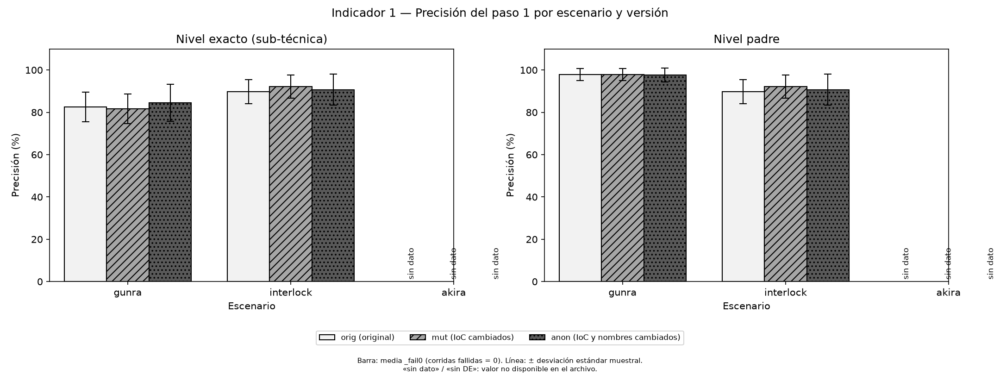
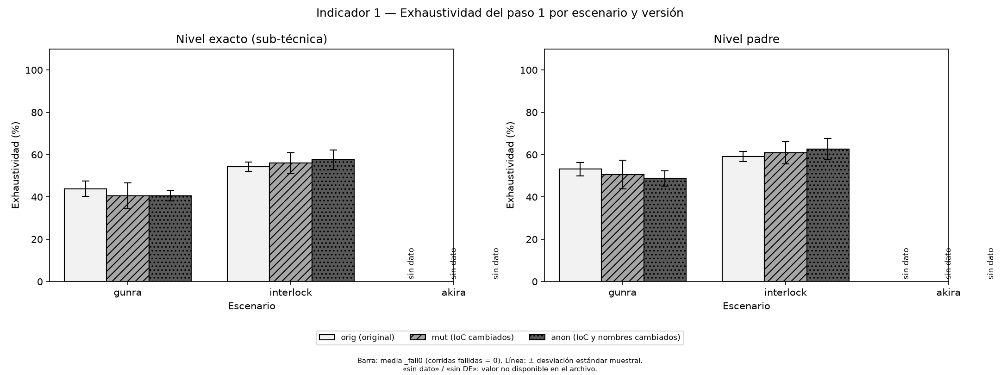
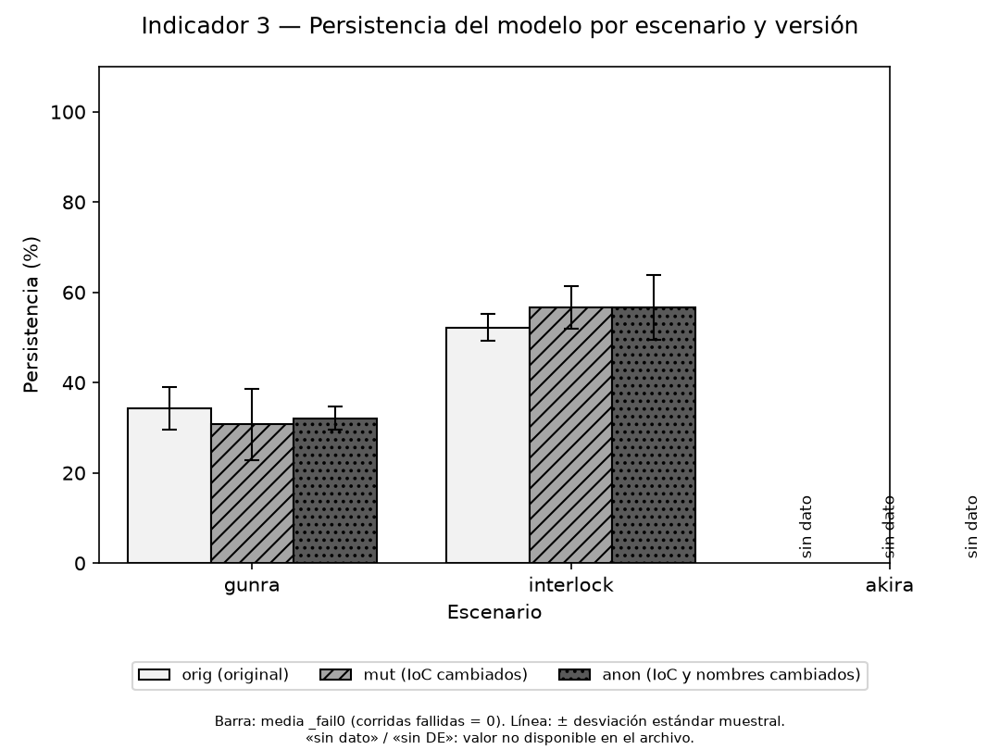

# Resumen de resultados — corrida `2026-10-18-main`

**RESULTADO PARCIAL: faltan escenarios** — ESCENARIOS OMITIDOS: akira (sin texto local)

Generado con `aem report` a partir de `runs/2026-10-18-main/results/results.json`. Los números se copian tal como están en ese archivo, sin redondear.

- Modelo (ID): `gemini-3.8-flash`
- Versión del modelo informada por la API: gemini-3.8-flash
- Fecha de la corrida: 2026-10-18 (inicio 2026-10-18T18:15:16+00:00, fin 2026-10-18T18:15:20+00:00)
- Hash SHA-256 de las plantillas de prompt: `extract_v1.txt=950aafbfbcae093c37aa822069fbc6adae83b13631344bcd9603363c9acb6ec3; summary_v1.txt=8f199eae921a1064b44f197842a26489edd0ca4b36c2710f514fd668500cea1b`
- Origen de las respuestas: gemini-api · temperatura 0 · ATT&CK 19.2 · 5 corridas por escenario × versión
- Porcentajes en %. «sin dato disponible»: el archivo no tiene el valor (sin corridas o valor no definido).

## Corridas

| Escenario | Versión | Corridas totales | Corridas válidas | Corridas fallidas | Corridas vacías |
|---|---|---|---|---|---|
| gunra | orig | 5 | 5 | 0 | 0 |
| gunra | mut | 5 | 5 | 0 | 0 |
| gunra | anon | 5 | 5 | 0 | 0 |
| interlock | orig | 5 | 5 | 0 | 0 |
| interlock | mut | 5 | 5 | 0 | 0 |
| interlock | anon | 5 | 5 | 0 | 0 |

## Indicador 1 — Precisión y exhaustividad del paso 1 (%)

Media principal: `_fail0`; `_valid` es secundaria (D-67). DE: desviación estándar muestral.

### Precisión

| Escenario | Versión | Nivel | Precisión media _fail0 | DE _fail0 | Precisión media _valid | DE _valid | Corridas totales | Corridas válidas | Corridas fallidas |
|---|---|---|---|---|---|---|---|---|---|
| gunra | orig | exacto (sub-técnica) | 82.5 | 6.95 | 82.5 | 6.95 | 5 | 5 | 0 |
| gunra | orig | padre | 97.89 | 2.88 | 97.89 | 2.88 | 5 | 5 | 0 |
| gunra | mut | exacto (sub-técnica) | 81.62 | 7.0 | 81.62 | 7.0 | 5 | 5 | 0 |
| gunra | mut | padre | 97.89 | 2.9 | 97.89 | 2.9 | 5 | 5 | 0 |
| gunra | anon | exacto (sub-técnica) | 84.52 | 8.81 | 84.52 | 8.81 | 5 | 5 | 0 |
| gunra | anon | padre | 97.64 | 3.24 | 97.64 | 3.24 | 5 | 5 | 0 |
| interlock | orig | exacto (sub-técnica) | 89.83 | 5.69 | 89.83 | 5.69 | 5 | 5 | 0 |
| interlock | orig | padre | 89.83 | 5.69 | 89.83 | 5.69 | 5 | 5 | 0 |
| interlock | mut | exacto (sub-técnica) | 92.21 | 5.53 | 92.21 | 5.53 | 5 | 5 | 0 |
| interlock | mut | padre | 92.21 | 5.53 | 92.21 | 5.53 | 5 | 5 | 0 |
| interlock | anon | exacto (sub-técnica) | 90.73 | 7.32 | 90.73 | 7.32 | 5 | 5 | 0 |
| interlock | anon | padre | 90.73 | 7.32 | 90.73 | 7.32 | 5 | 5 | 0 |
| akira | orig | exacto (sub-técnica) | sin dato disponible | sin dato disponible | sin dato disponible | sin dato disponible | 0 | 0 | 0 |
| akira | orig | padre | sin dato disponible | sin dato disponible | sin dato disponible | sin dato disponible | 0 | 0 | 0 |
| akira | mut | exacto (sub-técnica) | sin dato disponible | sin dato disponible | sin dato disponible | sin dato disponible | 0 | 0 | 0 |
| akira | mut | padre | sin dato disponible | sin dato disponible | sin dato disponible | sin dato disponible | 0 | 0 | 0 |
| akira | anon | exacto (sub-técnica) | sin dato disponible | sin dato disponible | sin dato disponible | sin dato disponible | 0 | 0 | 0 |
| akira | anon | padre | sin dato disponible | sin dato disponible | sin dato disponible | sin dato disponible | 0 | 0 | 0 |

### Exhaustividad

| Escenario | Versión | Nivel | Exhaustividad media _fail0 | DE _fail0 | Exhaustividad media _valid | DE _valid | Corridas totales | Corridas válidas | Corridas fallidas |
|---|---|---|---|---|---|---|---|---|---|
| gunra | orig | exacto (sub-técnica) | 43.89 | 3.62 | 43.89 | 3.62 | 5 | 5 | 0 |
| gunra | orig | padre | 53.12 | 3.12 | 53.12 | 3.12 | 5 | 5 | 0 |
| gunra | mut | exacto (sub-técnica) | 40.56 | 6.09 | 40.56 | 6.09 | 5 | 5 | 0 |
| gunra | mut | padre | 50.62 | 6.77 | 50.62 | 6.77 | 5 | 5 | 0 |
| gunra | anon | exacto (sub-técnica) | 40.56 | 2.48 | 40.56 | 2.48 | 5 | 5 | 0 |
| gunra | anon | padre | 48.75 | 3.56 | 48.75 | 3.56 | 5 | 5 | 0 |
| interlock | orig | exacto (sub-técnica) | 54.4 | 2.19 | 54.4 | 2.19 | 5 | 5 | 0 |
| interlock | orig | padre | 59.13 | 2.38 | 59.13 | 2.38 | 5 | 5 | 0 |
| interlock | mut | exacto (sub-técnica) | 56.0 | 4.9 | 56.0 | 4.9 | 5 | 5 | 0 |
| interlock | mut | padre | 60.87 | 5.32 | 60.87 | 5.32 | 5 | 5 | 0 |
| interlock | anon | exacto (sub-técnica) | 57.6 | 4.56 | 57.6 | 4.56 | 5 | 5 | 0 |
| interlock | anon | padre | 62.61 | 4.96 | 62.61 | 4.96 | 5 | 5 | 0 |
| akira | orig | exacto (sub-técnica) | sin dato disponible | sin dato disponible | sin dato disponible | sin dato disponible | 0 | 0 | 0 |
| akira | orig | padre | sin dato disponible | sin dato disponible | sin dato disponible | sin dato disponible | 0 | 0 | 0 |
| akira | mut | exacto (sub-técnica) | sin dato disponible | sin dato disponible | sin dato disponible | sin dato disponible | 0 | 0 | 0 |
| akira | mut | padre | sin dato disponible | sin dato disponible | sin dato disponible | sin dato disponible | 0 | 0 | 0 |
| akira | anon | exacto (sub-técnica) | sin dato disponible | sin dato disponible | sin dato disponible | sin dato disponible | 0 | 0 | 0 |
| akira | anon | padre | sin dato disponible | sin dato disponible | sin dato disponible | sin dato disponible | 0 | 0 | 0 |

## Indicador 2 — Corrección del cruce de cobertura (paso 2)

| Escenario | Técnicas de referencia | Coincidencias | Exactitud (%) | Discrepancias |
|---|---|---|---|---|
| gunra | 36 | 36 | 100.0 | ninguna |
| interlock | 25 | 25 | 100.0 | ninguna |
| akira | 38 | 38 | 100.0 | ninguna |

## Indicador 3 — Persistencia en el reconocimiento de la exposición (%)

Denominador: técnicas de referencia con brecha (modelo) o todas las técnicas de referencia (tradicional). Media principal del modelo: `_fail0`. Corridas totales y válidas por versión: tabla «Corridas».

### Media principal: `_fail0`

| Escenario | Enfoque | Denominador (técnicas) | orig media _fail0 | orig DE _fail0 | mut media _fail0 | mut DE _fail0 | anon media _fail0 | anon DE _fail0 | mut/orig _fail0 | anon/orig _fail0 | Corridas fallidas | Coincidencias de IoC |
|---|---|---|---|---|---|---|---|---|---|---|---|---|
| gunra | modelo | 28 | 34.29 | 4.79 | 30.71 | 7.82 | 32.14 | 2.53 | 0.8958 | 0.9375 | orig 0, mut 0, anon 0 |  |
| gunra | tradicional | 36 | 100.0 | determinístico | 0.0 | determinístico | 0.0 | determinístico | 0.0 | 0.0 | no aplica (sin LLM) | orig 17, mut 0, anon 0 |
| interlock | modelo | 18 | 52.22 | 3.04 | 56.67 | 4.65 | 56.67 | 7.24 | 1.0851 | 1.0851 | orig 0, mut 0, anon 0 |  |
| interlock | tradicional | 25 | 100.0 | determinístico | 0.0 | determinístico | 0.0 | determinístico | 0.0 | 0.0 | no aplica (sin LLM) | orig 19, mut 0, anon 0 |
| akira | modelo | 25 | sin dato disponible | sin dato disponible | sin dato disponible | sin dato disponible | sin dato disponible | sin dato disponible | sin dato disponible | sin dato disponible | orig 0, mut 0, anon 0 |  |
| akira | tradicional | 38 | sin dato disponible | sin dato disponible | sin dato disponible | sin dato disponible | sin dato disponible | sin dato disponible | sin dato disponible | sin dato disponible | no aplica (sin LLM) | sin dato disponible |

### Media secundaria: `_valid`

| Escenario | Enfoque | Denominador (técnicas) | orig media _valid | orig DE _valid | mut media _valid | mut DE _valid | anon media _valid | anon DE _valid | mut/orig _valid | anon/orig _valid | Corridas fallidas | Coincidencias de IoC |
|---|---|---|---|---|---|---|---|---|---|---|---|---|
| gunra | modelo | 28 | 34.29 | 4.79 | 30.71 | 7.82 | 32.14 | 2.53 | 0.8958 | 0.9375 | orig 0, mut 0, anon 0 |  |
| gunra | tradicional | 36 | 100.0 | determinístico | 0.0 | determinístico | 0.0 | determinístico | 0.0 | 0.0 | no aplica (sin LLM) | orig 17, mut 0, anon 0 |
| interlock | modelo | 18 | 52.22 | 3.04 | 56.67 | 4.65 | 56.67 | 7.24 | 1.0851 | 1.0851 | orig 0, mut 0, anon 0 |  |
| interlock | tradicional | 25 | 100.0 | determinístico | 0.0 | determinístico | 0.0 | determinístico | 0.0 | 0.0 | no aplica (sin LLM) | orig 19, mut 0, anon 0 |
| akira | modelo | 25 | sin dato disponible | sin dato disponible | sin dato disponible | sin dato disponible | sin dato disponible | sin dato disponible | sin dato disponible | sin dato disponible | orig 0, mut 0, anon 0 |  |
| akira | tradicional | 38 | sin dato disponible | sin dato disponible | sin dato disponible | sin dato disponible | sin dato disponible | sin dato disponible | sin dato disponible | sin dato disponible | no aplica (sin LLM) | sin dato disponible |

El gráfico muestra solo el enfoque del modelo; la fila del enfoque tradicional está en la tabla (C1).

## Indicador 4 — Fidelidad de los resúmenes (chequeo automático)

| Técnicas resumidas | Fallos del LLM | Chequeo automático ok | Chequeo automático ok (%) | Revisión manual |
|---|---|---|---|---|
| 49 | 0 | 49 | 100.0 | pendiente (hoja de revisión) |

## Indicador 5 — Cumplimiento de los límites (violaciones)

`_fail0` y `_valid` con el mismo peso (D-67).

| Escenario | Versión | Salida | Violaciones media _fail0 | DE _fail0 | Violaciones media _valid | DE _valid | Total de violaciones | Campos extra | Texto valorativo | Corridas totales | Corridas válidas | Corridas fallidas |
|---|---|---|---|---|---|---|---|---|---|---|---|---|
| gunra | orig | paso 1 (extracción) | 0.0 | 0.0 | 0.0 | 0.0 | 0 | 0 | 0 | 5 | 5 | 0 |
| gunra | mut | paso 1 (extracción) | 0.0 | 0.0 | 0.0 | 0.0 | 0 | 0 | 0 | 5 | 5 | 0 |
| gunra | anon | paso 1 (extracción) | 0.0 | 0.0 | 0.0 | 0.0 | 0 | 0 | 0 | 5 | 5 | 0 |
| interlock | orig | paso 1 (extracción) | 0.0 | 0.0 | 0.0 | 0.0 | 0 | 0 | 0 | 5 | 5 | 0 |
| interlock | mut | paso 1 (extracción) | 0.0 | 0.0 | 0.0 | 0.0 | 0 | 0 | 0 | 5 | 5 | 0 |
| interlock | anon | paso 1 (extracción) | 0.0 | 0.0 | 0.0 | 0.0 | 0 | 0 | 0 | 5 | 5 | 0 |
| akira | orig | paso 1 (extracción) | sin dato disponible | sin dato disponible | sin dato disponible | sin dato disponible | sin dato disponible | sin dato disponible | sin dato disponible | 0 | 0 | 0 |
| akira | mut | paso 1 (extracción) | sin dato disponible | sin dato disponible | sin dato disponible | sin dato disponible | sin dato disponible | sin dato disponible | sin dato disponible | 0 | 0 | 0 |
| akira | anon | paso 1 (extracción) | sin dato disponible | sin dato disponible | sin dato disponible | sin dato disponible | sin dato disponible | sin dato disponible | sin dato disponible | 0 | 0 | 0 |
| todos | - | paso 4 (resúmenes, uno por técnica) | sin dato disponible | sin dato disponible | sin dato disponible | sin dato disponible | 0 | 0 | 0 | 49 | 49 | ver indicador 4 (llm_failures) |

## Escenarios omitidos

- escenarios_omitidos: akira (sin texto local)
- Resultado parcial: sí. Las tablas del LLM no tienen corridas de los escenarios omitidos; si aparecen filas suyas en el indicador 2 o en el enfoque tradicional del indicador 3, esas no dependen del LLM (D-73).

## Datos faltantes

- Escenarios o versiones no evaluados: akira: orig, akira: mut, akira: anon.
- Indicador 1: 48 celda(s) con «sin dato disponible» — `precision_mean_fail0` (6), `precision_sd_fail0` (6), `precision_mean_valid` (6), `precision_sd_valid` (6), `recall_mean_fail0` (6), `recall_sd_fail0` (6), `recall_mean_valid` (6), `recall_sd_valid` (6).
- Indicador 3: 33 celda(s) con «sin dato disponible» — `orig_mean_fail0` (2), `orig_sd_fail0` (2), `orig_mean_valid` (2), `orig_sd_valid` (2), `mut_mean_fail0` (2), `mut_sd_fail0` (2), `mut_mean_valid` (2), `mut_sd_valid` (2), `anon_mean_fail0` (2), `anon_sd_fail0` (2), `anon_mean_valid` (2), `anon_sd_valid` (2), `persistence_mut_over_orig_fail0` (2), `persistence_mut_over_orig_valid` (2), `persistence_anon_over_orig_fail0` (2), `persistence_anon_over_orig_valid` (2), `ioc_matches` (1).
- Indicador 5: 25 celda(s) con «sin dato disponible» — `violations_total` (3), `violations_mean_fail0` (4), `violations_sd_fail0` (4), `violations_mean_valid` (4), `violations_sd_valid` (4), `extra_fields` (3), `evaluative_text` (3).
- Columna `data_sources` de las salidas por corrida: 0 de 505 filas con «sin dato disponible» (30 archivos `*_exposure.csv`).
- Columna `prevalence` de las salidas por corrida: 505 de 505 filas con «sin dato disponible» (30 archivos `*_exposure.csv`).
- Revisión manual de los indicadores 4 y 5: no está en `results.json`; ver las hojas en `eval/review_sheets/`.

## Lo que estos números permiten y no permiten afirmar

- **C1 — El enfoque tradicional da 0 % por construcción:** en `mut` y `anon` ningún IoC del original sobrevive (lo verifica el código), así que el enfoque tradicional siempre da 0 %. Es un punto de referencia, **no una medición independiente**.
- **C2 — Reconocimiento por el nombre:** `mut` conserva los nombres del actor y del malware, así que parte de la persistencia del modelo en `mut` podría deberse a que el LLM reconoce la amenaza por su nombre y no por el comportamiento. La versión `anon`, que reemplaza esos nombres, sirve para controlarlo (D-72).
- **C3 — Datos de entrenamiento:** el modelo de lenguaje pudo conocer estos reportes (públicos) durante su entrenamiento; ni `mut` ni `anon` eliminan ese efecto.
- **D-67 — Corridas fallidas:** cada media se informa dos veces. `_fail0` cuenta cada corrida fallida como 0; `_valid` usa solo las corridas válidas. En los indicadores 1 y 3 la media principal es `_fail0`. Si no hay corridas fallidas, ambas coinciden; si las hay, `_fail0` mezcla la calidad de las respuestas con la tasa de fallos y `_valid` la deja fuera, así que ninguna de las dos por sí sola describe ambas cosas.
- **D-67 — Indicador 5:** las dos medias tienen el mismo peso. Contar una corrida fallida como 0 violaciones favorece al modelo.
- **D-67 — Corridas vacías:** una corrida válida sin técnicas propuestas tiene precisión indefinida y no entra en las medias de precisión.
- La razón `mut/orig` o `anon/orig` no muestra los niveles absolutos: las medias absolutas están en la tabla del indicador 3.
- La desviación estándar es muestral (n−1) sobre las corridas de cada escenario × versión; con menos de 2 valores figura «sin dato disponible».
- Los números describen estos escenarios, este modelo (versión y fecha indicadas arriba) y estas plantillas de prompt. No describen otros reportes, otros modelos ni otras versiones del mismo modelo.
- No hay indicador para el paso 3 ni para la revisión global (criterio del analista). Los indicadores 4 y 5 tienen además una revisión manual, cuyo resultado no está en este resumen.
